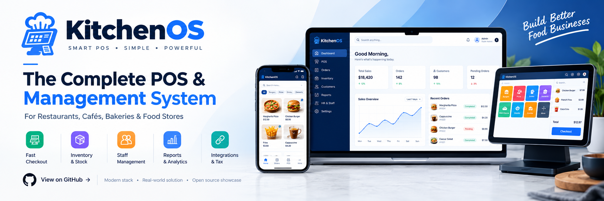
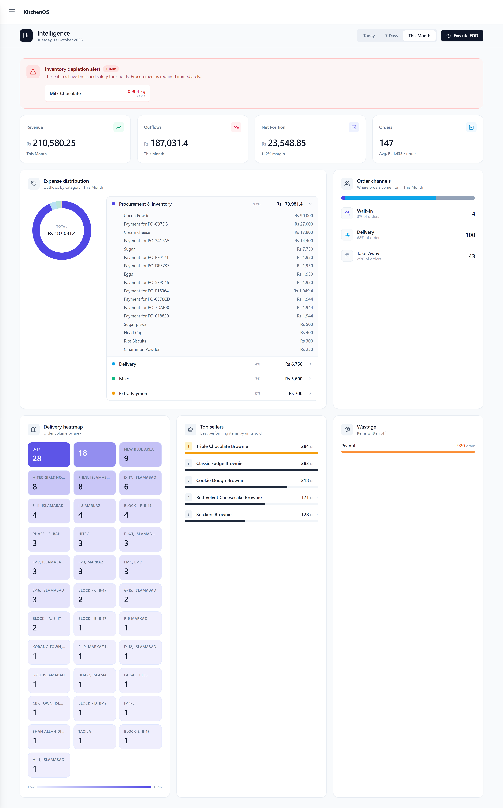
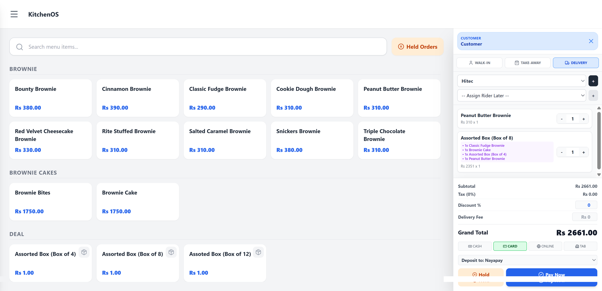
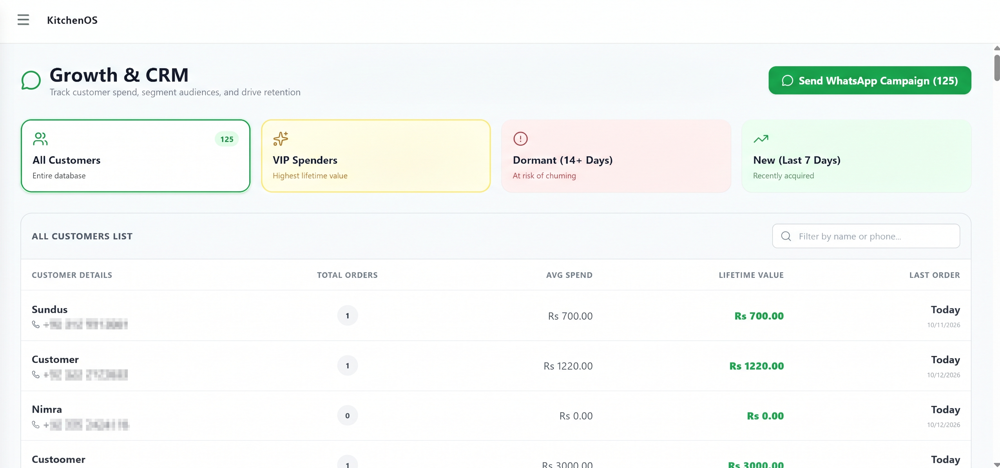
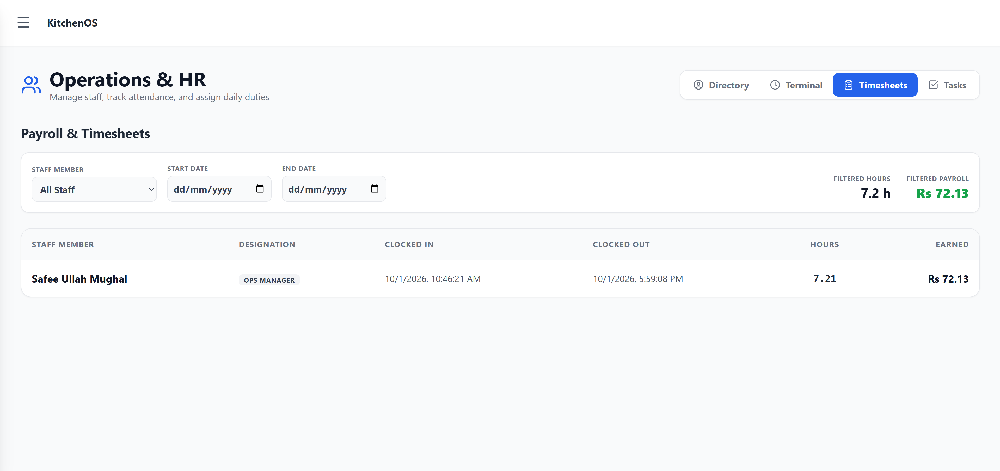
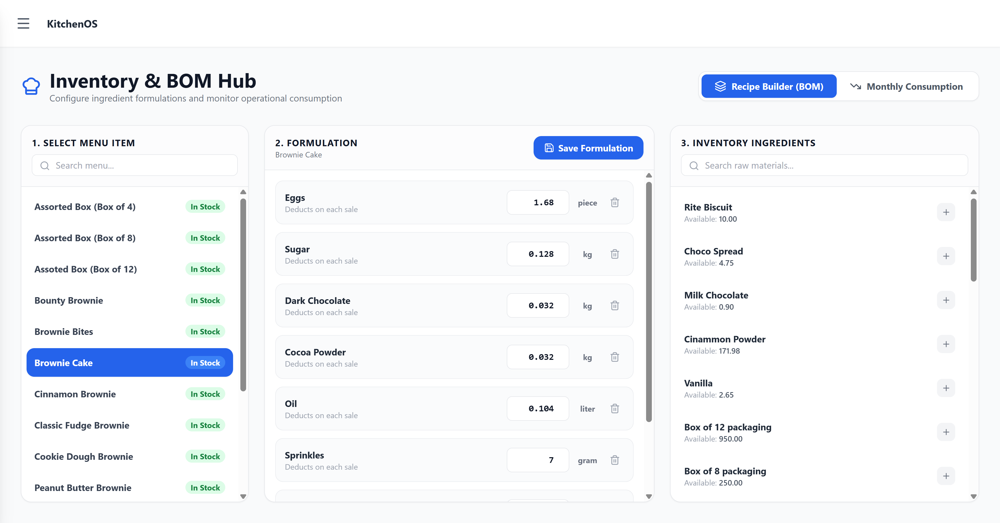

  

  # KitchenOS 🍳
  **The Complete Enterprise POS & Cloud Kitchen Management Platform**
  
  
  
  

  *Note: KitchenOS is a proprietary, subscription-based enterprise solution. This repository serves as a technical showcase and portfolio overview of the platform's architecture and capabilities.*

---

## 📖 Overview
KitchenOS is a full-stack, comprehensive restaurant and cloud-kitchen operating system engineered to handle everything from front-of-house sales to complex back-of-house logistics. Built with a robust Flask and PostgreSQL backend, it bridges the gap between intelligent inventory management, customer retention marketing, real-time storefront syncing, and localized tax compliance.

## ✨ Core Ecosystem

### 🏪 Front-of-House & Customer Experience
*   **Lightning-Fast POS:** Touch-optimized point-of-sale interface designed for rapid order entry and high-volume environments.
*   **Client Storefront:** Fully integrated web storefront allowing customers to place orders directly into the KitchenOS ecosystem.
*   **Live Order Tracking:** Real-time status updates for both the kitchen staff and the customer.
*   **CRM & WhatsApp Marketing:** Built-in customer relationship manager seamlessly integrated with WhatsApp for targeted marketing broadcasts and automated customer retention campaigns.
*   **Automated Alerts:** Email notifications dispatched for order statuses and End-of-Day (EOD) ledgers.

### ⚙️ Back-of-House & Operations
*   **Intelligent Dashboard:** High-level overview of daily operations, sales metrics, and real-time expense management.
*   **Dynamic Recipe BOM:** Advanced inventory tracking that deducts raw materials based on exact Bill of Materials (BOM) per dish sold.
*   **HR & Staff Management:** Comprehensive workforce portal for attendance tracking, payroll automation, and strict role-based access control (RBAC).
*   **Smart Supplier Management:** Automated Purchase Order (PO) generation triggered by low-stock thresholds, complete with email alerts.
*   **Delivery Fleet Management:** End-to-end tracking and assignment for in-house delivery fleets.
*   **Account & Ledger Management:** Built-in financial tracking for expenses, daily reconciliations, and supplier payments.

### 🔗 Enterprise Integrations
*   **Shopify Integration:** Bi-directional sync for omni-channel retail operations.
*   **FBR Integration:** Automated compliance and real-time tax reporting with the Federal Board of Revenue.

---

## 🖥️ System Interface

### The Intelligent Dashboard
> *A centralized command center for restaurant owners to track expenses, sales, and automated ledgers.*

### Point of Sale Terminal
> *Streamlined checkout flow and live order management directly from the web storefront.*

### CRM & WhatsApp Automation
> *Engage directly with your customer base using targeted WhatsApp marketing campaigns.*

### HR & Staff Management
> *Complete oversight of employee attendance, payroll, and system access rights.*

### Automated BOM & Inventory 
> *Precision tracking that turns finished sales into raw material deductions and automated supplier POs.*

---

## 🛠️ Technical Architecture 

While the source code is closed, the system is engineered using modern, scalable web technologies to ensure zero-downtime during peak service hours.

*   **Backend:** Python, Flask 
*   **Database:** PostgreSQL (Relational integrity for BOMs and Financial Ledgers)
*   **Frontend:** HTML5, CSS3, JavaScript (Responsive, touch-first design)
*   **Infrastructure:** Deployed on scalable Linux VPS environments with automated task scheduling for EOD reporting and stock alerts.

## 💼 Connect & Demo

KitchenOS is a flagship product developed by **Boldise Technologies**. 

If you are interested in a live demonstration, discussing the architecture, or exploring enterprise licensing, please get in touch:

*   **Developer/Architect:** Safee Ullah Mughal
*   **LinkedIn:** [Your LinkedIn URL]
*   **Email:** [Your Email Address]
*   **Company:** [Boldise Technologies URL]

---

  <i>Engineered for scale, speed, and precision.</i>

