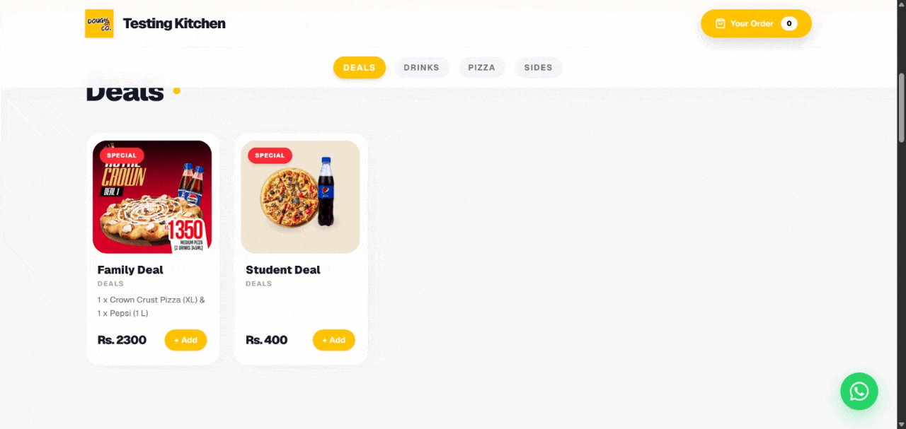
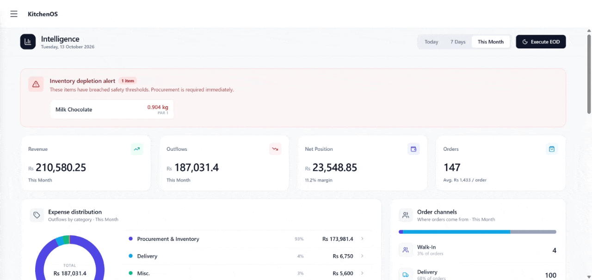
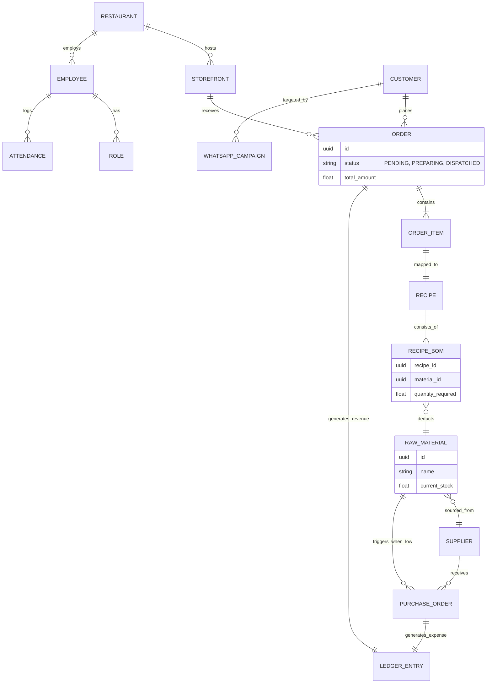
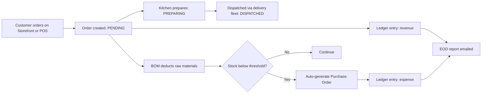

<div align="center">
  

  # KitchenOS 🍳
  **The Complete Enterprise POS & Cloud Kitchen Management Platform**

  [](https://test.boldise.com)
  [](https://boldise.com)
  []()

  *KitchenOS is a proprietary, subscription-based enterprise solution. This repository is a technical showcase and portfolio overview of the platform's architecture and capabilities. The source code is closed.*
</div>

---

## 📑 Table of Contents
- [Overview](#-overview)
- [Core Ecosystem](#-core-ecosystem)
- [System Interface](#️-system-interface)
- [Technical Architecture](#️-technical-architecture)
- [How a Sale Flows Through the System](#-how-a-sale-flows-through-the-system)
- [Why KitchenOS](#-why-kitchenos)
- [Licensing & Demo](#-licensing--demo)
- [Connect](#-connect)

---

## 📖 Overview
KitchenOS is a full-stack restaurant and cloud-kitchen operating system built to handle everything from front-of-house sales to back-of-house logistics. Powered by a Python backend, it connects four areas that most kitchens run as separate tools:

- **Sales:** a web storefront and a touch-optimized POS feeding one order pipeline.
- **Inventory:** recipe-level BOM tracking that deducts raw materials per dish sold.
- **Customer retention:** a built-in CRM with WhatsApp marketing broadcasts.
- **Finance & compliance:** ledgers, daily reconciliation, and localized tax handling.

One platform, one database, one source of truth.

---

## ✨ Core Ecosystem

### 🏪 Front-of-House & Customer Experience
| Capability | Description |
|---|---|
| **Live Storefront** | Fully integrated web storefront ([test.boldise.com](https://test.boldise.com)) where customers place orders directly into the KitchenOS ecosystem. |
| **Lightning-Fast POS** | Touch-optimized point-of-sale interface designed for rapid order entry in high-volume environments. |
| **Live Order Tracking** | Real-time status updates for both kitchen staff and customers. |
| **CRM & WhatsApp Marketing** | Built-in customer relationship manager integrated with WhatsApp for targeted marketing broadcasts. |
| **Automated Alerts** | Email notifications for order statuses and End-of-Day (EOD) ledgers. |

### ⚙️ Back-of-House & Operations
| Capability | Description |
|---|---|
| **Intelligent Dashboard** | High-level overview of daily operations, sales metrics, and real-time expense management. |
| **Dynamic Recipe BOM** | Inventory tracking that deducts raw materials based on the exact Bill of Materials of each dish sold. |
| **HR & Staff Management** | Workforce portal for attendance tracking, payroll automation, and strict role-based access control. |
| **Smart Supplier Management** | Automated Purchase Order (PO) generation triggered by low-stock thresholds. |
| **Delivery Fleet Management** | End-to-end tracking and assignment for in-house delivery fleets. |
| **Account & Ledger Management** | Financial tracking for expenses, daily reconciliations, and supplier payments. |

---

## 🖥️ System Interface

### The Live Storefront
> *Customer-facing web portal for seamless online ordering.*



### The Intelligent Dashboard
> *A centralized command center for owners to track expenses, sales, and automated ledgers.*



### Point of Sale Terminal
> *Streamlined checkout flow and live order management.*


### CRM & WhatsApp Automation
> *Engage your customer base directly with targeted WhatsApp marketing campaigns.*


### HR & Staff Management
> *Complete oversight of employee attendance, payroll, and system access rights.*


### Automated BOM & Inventory
> *Precision tracking that turns finished sales into raw material deductions and automated supplier POs.*


---

## 🛠️ Technical Architecture

### Tech Stack


| Layer | Technology |
|---|---|
| Backend | Python, Flask (modular blueprints) |
| Database | PostgreSQL via SQLAlchemy |
| Frontend | JavaScript |
| Hosting | Ubuntu server, WSGI deployment |
| Background jobs | Scheduled CRON tasks |

The system is engineered with modern, scalable web technologies to keep service stable during peak hours.

### Backend Organization (Mock Structure)
The application uses a modular blueprint architecture that separates POS operations, storefront APIs, and background tasks.

```text
kitchenos-core/
├── app/
│   ├── pos/              # Point of Sale touch interface routes
│   ├── storefront/       # Public-facing web ordering endpoints
│   ├── inventory/        # BOM deduction and supplier PO logic
│   ├── crm/              # WhatsApp API integrations and marketing
│   └── models/           # SQLAlchemy database schemas
├── tasks/                # Automated CRON jobs (EOD reports, low-stock alerts)
├── config/               # Environment and deployment configurations
└── run.py                # WSGI application entry point
```

### System Entity Relationship (High-Level)
The diagram below shows the relational integrity linking front-of-house sales to back-of-house logistics.



---

## 🔄 How a Sale Flows Through the System



---

## 🎯 Why KitchenOS
- **Unified data:** orders, stock, staff, suppliers, and money live in one system instead of five.
- **Accurate costing:** per-dish BOM deduction shows real ingredient consumption.
- **Less manual work:** low-stock POs, EOD ledgers, and alerts run automatically.
- **Customer retention:** CRM and WhatsApp broadcasts are built in, not bolted on.
- **Controlled access:** strict role-based permissions across staff.

---

## 💼 Licensing & Demo
KitchenOS is a subscription-based enterprise product. For a live demonstration, an architecture discussion, or enterprise licensing, get in touch using the details below.

## 📬 Connect
KitchenOS is a flagship product developed by **[Boldise Technologies](https://boldise.com)**.

- **Developer / Architect:** Safee Ullah Mughal
- **LinkedIn:** [Your LinkedIn URL]
- **Email:** boldisetechnology@gmail.com
- **Company:** [boldise.com](https://boldise.com)
- **Live Storefront:** [test.boldise.com](https://test.boldise.com)

---

<div align="center">
  <sub>© Boldise Technologies. All rights reserved. This repository is a showcase only and does not grant any license to the proprietary source code.</sub>
</div>
